# OmniCheck

**A deterministic, multi-language static-analysis engine in C11.**


**Author:** [Tamer Osman](https://github.com/tamer4osman)

---

## Stop letting AI-generated code slip through the cracks

You're a developer or Vibe coder working in an age of AI assistance. You copy-paste a function, accept a generated PR, or merge a fast-follow—all before you can verify what the model "thought" was correct. Your CI pipeline blames the linter, but the linter's heuristics change tomorrow. Is this a false alarm or a real issue? Either way, your codebase gets flagged inconsistently.

**OmniCheck gives you certainty that AI, heuristics, or human error can't break.** It runs the same analysis every time, on any machine, producing byte-stable reports that are provably reproducible—not just claimed. The scanner never guesses, the sidecar never decides, and a broken advisor never breaks the scan.

---

## How OmniCheck works

Language support is **registered, not trained**: declarative language packs bind
file types to tree-sitter grammars and select which analysis passes run.
Analysis is graph traversal; output is a byte-stable JSON report with stable
finding fingerprints. An optional OmniDecide triage sidecar may *annotate*
findings (rank-only, fail-open) but never decides alone — the analyzer keeps
every verdict, the adviser only reorders attention.

---

## Table of contents

1. [Why OmniCheck](#why-omnicheck)
2. [Screenshots](#screenshots)
3. [Quick start](#quick-start)
4. [CLI reference (commands, options, config)](#cli-reference-commands-options-config)
5. [Project statistics](#project-statistics)
6. [How a scan works](#how-a-scan-works)
7. [Module map](#module-map)
8. [Static structure](#static-structure)
9. [The rule registry](#the-rule-registry)
10. [Language packs (register-not-train)](#language-packs-register-not-train)
11. [The import-resolver family](#the-import-resolver-family)
12. [OmniDecide triage sidecar](#omnidecide-triage-sidecar)
13. [Determinism contract](#determinism-contract)
14. [Verification and evidence](#verification-and-evidence)
15. [Milestones](#milestones)
16. [Repository layout](#repository-layout)
17. [Documentation map](#documentation-map)
18. [License](#license)
19. [Author](#author)

---

## Why OmniCheck

Classic linters mix three concerns in one blob: *what is true* (structural
facts), *how bad is it* (severity) and *what to look at first* (attention).
OmniCheck separates them hard:

- **Truth is structural.** Every rule (OC001–OC011) is intent-blind and
  deterministic — it fires on a structurally true statement ("this function
  spans 74 lines", "this pinned dependency is in the OSV snapshot") or it does
  not fire. There are no heuristics, no entropy guesses, no regex free-styling,
  and no AI in the judgment path.
- **Severity is fixed by the registry.** Rules never up- or downgrade
  themselves based on "context".
- **Attention is delegated, opt-in, and revocable.** The OmniDecide sidecar may
  *rank* findings for the reader, but it can never delete, invent, re-severitify
  or redefine one. If the sidecar is missing, broken, slow or lying, the scan
  fails open and continues unranked.

The payoff is reproducibility: the same inputs always produce the same bytes —
same compiler or a different one, Release or sanitizer build, today or on the
formal gate date. That property is executable and continuously proven, not
claimed (see [Verification and evidence](#verification-and-evidence)).

### Design principles for the AI era

| Principle | What it means in the code |
| --- | --- |
| Register, not train | Languages are `pack.json` descriptors + vendored grammars; adding one touches zero analysis code |
| Determinism by construction | sorted discovery, fixed JSON field order, no wall-clock in reports, `(file, line, col, rule)` sort |
| Honest failure | parse errors are named records and drive exit 2; nothing is silently dropped, every cap has a counter |
| Fail-open sidecar | triage defects can never break a scan; auditor tools are the only components allowed to fail closed |
| Evidence, not vibes | every milestone gate is a re-runnable script whose verdict JSON is committed |

---

## Screenshots

Real terminal captures of the shipped `oc` binary (v0.3.0) at the SPRINT-24
tree, produced by the committed pipeline `scripts/gen_screenshots.py` —
re-run it after every adoption so the captures track the live `packs:` line.
The report text is **byte-exact**: findings, fingerprints, ranks and counters
are exactly what the tool printed; only terminal presentation (window chrome,
token coloring) is added. Every run exits `1` here by design: findings sit
at/above the `--fail-on warn` threshold (`oc compat` exits `1` on a BREAKING
verdict, its designed contract).

<p align="center">
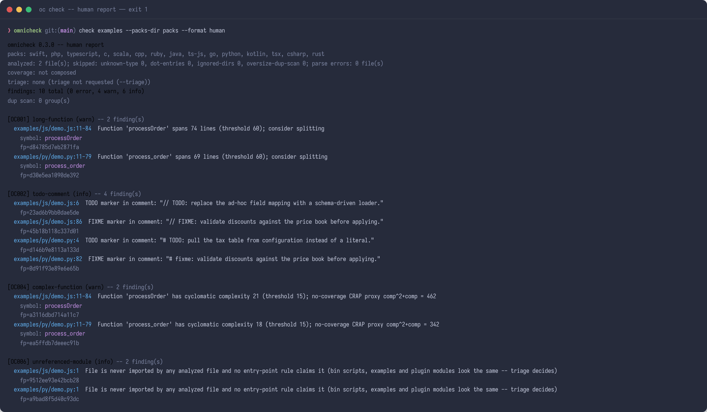
<br><em><code>oc check</code> — the deterministic human report: grouped rule sections, stable <code>fp=</code> fingerprints, and the <code>packs:</code> line listing all fifteen registered languages.</em>
</p>

<p align="center">
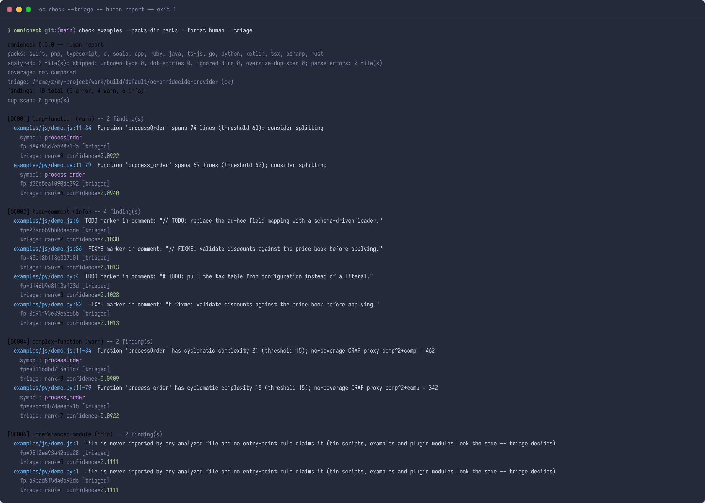
<br><em>With <code>--triage</code> and the vendored OmniDecide provider: rank-only annotations (<code>triage: rank=N confidence=…</code>) — order, severities and the finding set are untouched.</em>
</p>

<p align="center">
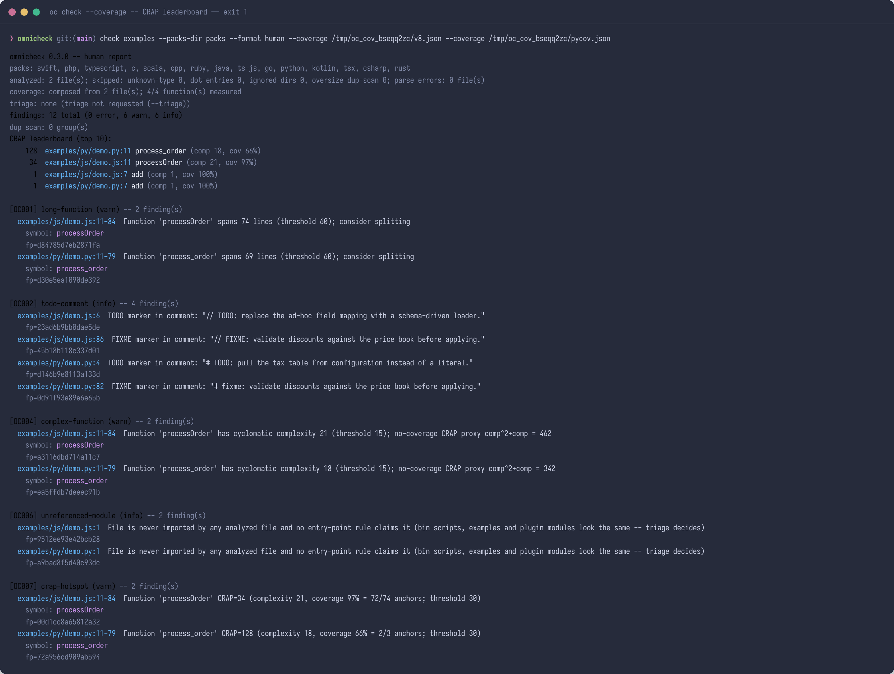
<br><em>Coverage composed from V8 + coverage.py files: the CRAP leaderboard (top measured functions by CRAP desc — <code>process_order comp 18, cov 66%</code> leads) and coverage-sensitive OC007 findings.</em>
</p>

<p align="center">
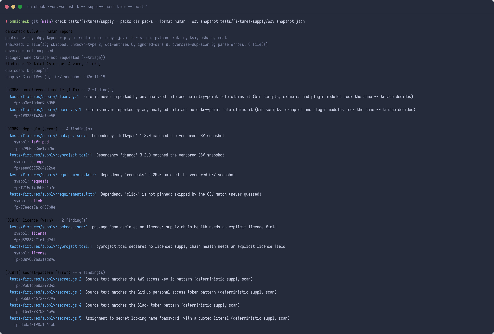
<br><em>The supply-chain tier against a vendored OSV snapshot: OC009 dep-vuln (error), OC010 licence (warn), OC011 secret-pattern (error) — unpinned specs are reported, never guessed.</em>
</p>

<p align="center">
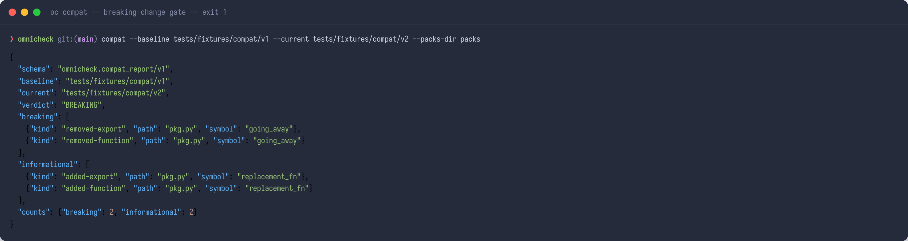
<br><em><code>oc compat</code> — the breaking-change gate: signature-level diff of two analysis roots; a removed export/function yields verdict <code>BREAKING</code> and exit 1 (<code>omnicheck.compat_report/v1</code>).</em>
</p>

<p align="center">
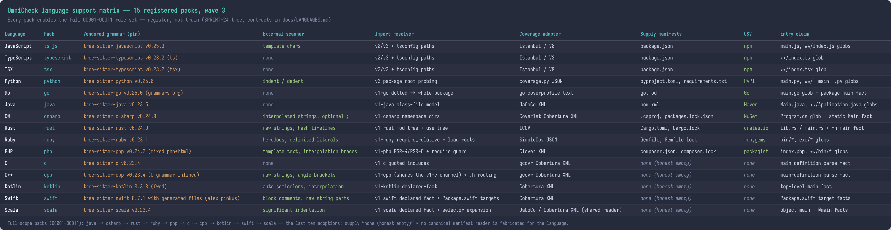
<br><em>The language support matrix as a figure (a rendered diagram, not a terminal capture): grammar pins, external scanners, resolver family, coverage adapters, supply manifests and entry claims for all fifteen packs.</em>
</p>

---

## Quick start

### 1. Build from source

Prerequisites: CMake ≥ 3.16 and a C11 compiler (`python3` only for the
acceptance scripts). Everything ships in-repo — **a fresh clone builds
offline**. The full matrix is verified with gcc 14.2 and clang 19.1.7.

```sh
git clone <this-repo> omnicheck && cd omnicheck
./scripts/vendor.sh                 # verify third_party integrity (VENDOR.sha256 manifests)
cmake --preset default              # Release, -Werror
cmake --build --preset default -j   # builds liboc, oc, oc-omnidecide-provider, oc-omnidecide-explain
ctest --preset default              # the full suite: 38 tests per cell
```

The sanitize preset runs every test under ASan+UBSan+LSan with leak detection:

```sh
cmake --preset sanitize && cmake --build --preset sanitize -j
ctest --preset sanitize
```

### 2. First scan

The `examples/` directory is an intentionally smelly two-file corpus (the
`packs:` line will list all fifteen registered languages regardless — packs
are loaded globally, only matching files are analyzed):

```sh
./build/default/oc check examples --packs-dir packs
```

Deterministic demo output (abridged):

```
info  OC002 examples/js/demo.js:6   [23ad6b9b...] TODO marker in comment: ...
warn  OC001 examples/js/demo.js:11  [18a5ee20...] Function 'processOrder' spans 74 lines (threshold 60)
...
```

Exit codes: `0` clean, `1` findings at/above `--fail-on` (default `warn`),
`2` tool error or files that failed to parse cleanly. Unparsed files are
listed in `parse_errors` (with `error_nodes`, `first_line`, `first_column`)
and counted in `meta.files_with_parse_errors` — a broken file can never
yield a silent exit-0 run.

### 3. Rank findings with the OmniDecide sidecar (opt-in)

```sh
OC_OMNIDECIDE_BIN=build/default/oc-omnidecide-provider \
  ./build/default/oc check examples --packs-dir packs --triage --format human
```

### 4. Compose coverage and light up the CRAP leaderboard

```sh
./build/default/oc check examples --packs-dir packs \
  --coverage coverage/v8.json --coverage coverage/pycov.json --format human
```

`--coverage FILE` accepts Istanbul, V8 (`NODE_V8_COVERAGE`), coverage.py and
`go test -coverprofile` JSON/text plus the per-language adapters of
[the language matrix](#language-packs-register-not-train); with coverage
composed, `oc check` emits the `crap_leaderboard` block (top 10 measured
functions by CRAP desc) and OC007 becomes coverage-sensitive.

### 5. Release packaging and the npm shim

```sh
scripts/package.sh                  # dist/omnicheck-<v>-linux-<arch>.tar.gz + sha256 sidecar
node npm/bin/oc-shim.js --version   # npm shim: OC_BIN | bin/native/oc | platform pkg
```

---

## CLI reference

Every command shares one pipeline (`oc_scan_run`), so LSP and MCP findings are
byte-identical to a plain `oc check` for the same inputs.

### Command table

| Command | What it does | Key options | Exit codes |
| --- | --- | --- | --- |
| `oc check [paths...]` | **The analyzer.** Discovers, parses, resolves, runs OC001–OC011 and prints the deterministic report (`omnicheck.report/v0`) as JSON or grouped human text | `--packs-dir`, `--config K=V` (repeatable), `--coverage FILE` (repeatable), `--osv-snapshot FILE`, `--triage`, `--fail-on info\|warn\|error`, `--format json\|human` | `0` clean · `1` findings ≥ `--fail-on` · `2` tool error / parse errors |
| `oc graph [paths...]` | **Graph dump.** Emits the unified graph as JSON — file/function/class/variable nodes, import edges; function nodes carry `complexity`, plus `coverage_pct`/`crap` when coverage is composed | `--packs-dir`, `--coverage FILE` | `0` / `2` |
| `oc packs [--packs-dir DIR]` | **Registry dump.** Lists every loaded language pack exactly as registered (schema, id, grammar, extensions, entry points, enabled passes) | `--packs-dir` | `0` / `2` |
| `oc lsp [--packs-dir DIR]` | **Editor integration.** LSP 3.17 server over stdio — publishes diagnostics and serves document symbols from the same scan pipeline | `--config K=V` | server loop |
| `oc mcp [--packs-dir DIR]` | **Agent integration.** MCP tools server over stdio (`scan`, `findings`, `rules`) so AI assistants consume the same deterministic findings | `--config K=V` | server loop |
| `oc compat --baseline DIR --current DIR` | **Breaking-change gate.** Diffs the public surface of two analysis roots (signature changes + removals); prints `omnicheck.compat_report/v1` and exits 1 on `BREAKING` | `--packs-dir` | `0` SAFE · `1` BREAKING · `2` tool error |
| `oc mutate [paths...] --test-cmd CMD` | **Mutation engine.** Generates operator mutants, runs the test suite per mutant, reports survivors (content-hash verdict cache) | `--test-cmd CMD` (required), `--timeout S` (default 30), `--cache FILE`, `--coverage FILE`, `--max-mutants N` | `0` all killed · `1` mutants survived · `2` tool error |
| `oc --version` / `oc --help` | Build identity / usage text | — | `0` |

### Shared options

| Option | Applies to | Meaning |
| --- | --- | --- |
| `--packs-dir DIR` | all scan-facing commands | language pack directory (default: `$OC_PACKS_DIR` or `./packs`) |
| `--config K=V` | check, lsp, mcp | pass option, repeatable — see the [rule configuration keys](#rule-configuration-keys) |
| `--coverage FILE` | check, graph, mutate | compose a coverage report; repeatable; enables OC007, the CRAP leaderboard and graph coverage fields |
| `--format json\|human` | check | `json` (default) is the byte-stable contract; `human` renders the grouped text report |
| `--fail-on LEVEL` | check | exit-1 threshold: `info`, `warn` (default) or `error` |
| `--osv-snapshot FILE` | check | vendored OSV snapshot (`omnicheck.osv_snapshot/v0`) for OC009; the snapshot date is echoed into the report meta |
| `--triage` | check | enable the OmniDecide rank-only sidecar (fail-open; also needs `OC_OMNIDECIDE_BIN`) |

### Rule configuration keys

| Key | Default | Tuned by |
| --- | --- | --- |
| `OC001.max_lines` | `60` | long-function span threshold |
| `OC004.max_complexity` | `15` | cyclomatic-complexity threshold |
| `OC007.max_crap` | `30` | CRAP hotspot threshold (coverage-sensitive) |
| `OC008.min_block` | `10` | minimum normalized block for duplicate-code |

### Environment variables

| Variable | Consumer | Meaning |
| --- | --- | --- |
| `OC_PACKS_DIR` | all commands | default pack directory when `--packs-dir` is absent |
| `OC_OMNIDECIDE_BIN` | `--triage` | path to the sidecar provider (rank-only, protocol v0) |
| `OC_OMNIDECIDE_TIMEOUT_S` | `--triage` | sidecar budget in seconds, 1..600 (default 3, the interactive profile) |
| `OC_OMNIDECIDE_ARTIFACTS_DIR` | provider | best-effort request/response artifacts for byte-exact replay |
| `OC_BIN` | npm shim | explicit path to the native `oc` binary |

CI wiring ships as templates: `templates/github-action/action.yml` (composite
action: build + `oc check --fail-on`) and `templates/ci/omnicheck-gate.yml`.

---

## Project statistics

All first-party numbers below are **derived from the tree** by
`scripts/audit_docs.py` and the gate fails on drift (the SPRINT-8 table
double-counted `src/passes/`; the derivation fixes the component set).
First-party code only — vendored third-party trees are accounted separately
in [The external boundary](#the-external-boundary).

### Internal: first-party code

| Component | Files | Lines of code |
| --- | ---: | ---: |
| `src/` implementation (excl. passes) | 31 | 22,089 |
| `src/passes/` built-in rules (11) | 11 | 927 |
| `include/oc/` public C11 API | 27 | 2,263 |
| `tools/` provider, auditor, mock | 4 | 1,074 |
| `tests/` suites (fixtures excluded) | 36 | 16,183 |
| `scripts/` acceptance + packaging + screenshot pipeline | 48 | 15,732 |
| `packs/` declarative language packs (15) | 15 | 416 |
| `templates/` CI gate templates | 3 | 194 |
| **Total first-party** | **200** | **60,980** |

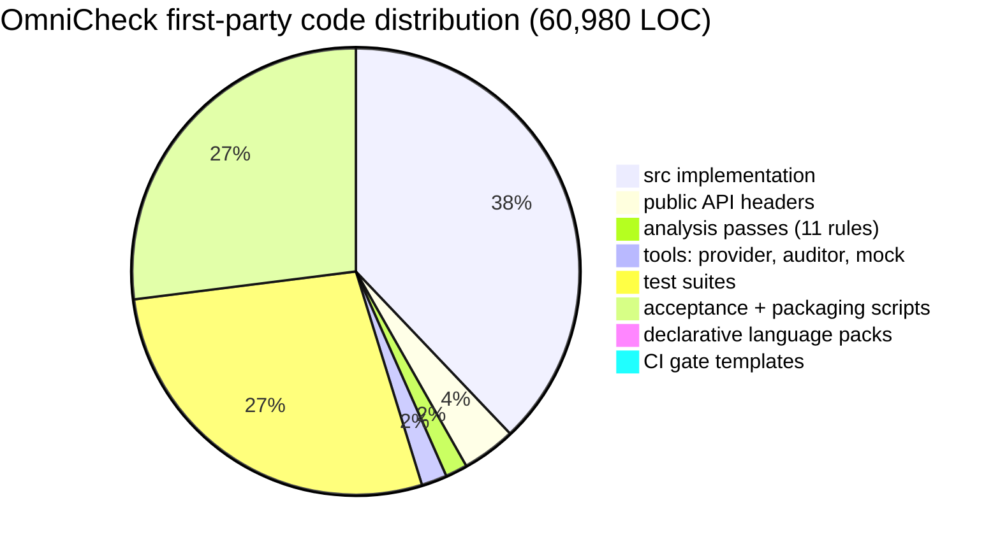

Headline counts:

- **11 analysis rules** (OC001–OC011), **7 CLI commands**, **6 published
  `omnicheck.*` JSON schemas** (`report/v0`, `pack/v0`, `compat_report/v1`,
  `mutation_report/v0`, `mutation_cache/v0`, `osv_snapshot/v0`)
- **15 languages** registered across **14 vendored grammar trees** (the
  TypeScript repo ships the `typescript` and `tsx` grammars from one source
  tree): JavaScript, TypeScript, TSX, Python, Go, Java, C#, Rust, Ruby, PHP,
  C, C++, Kotlin, Swift, Scala — **every pack enables the full OC001–OC011
  set** (contracts in `docs/LANGUAGES.md`)
- **38 ctest entries per build cell**, 4 cells (gcc 14.2 / clang 19.1.7 ×
  Release / ASan+UBSan+LSan); the vendored OmniDecide kernel's own suites add
  **583 in-repo checks** per cell
- **10,000-file determinism corpus**: generated-corpus digest
  `a4ec9ac9…37ecc`, ONE report digest across all build cells, worst Release
  wall **14.6 s** single-core against the 90 s budget (re-proven at the
  SPRINT-24 tree, `docs/evidence/m5_gate_verdict.json`)
- **11 reference-corpus gates** — one pinned upstream corpus per language,
  all green (see [External: validation corpora](#external-validation-corpora))

### The external boundary

Vendored third-party components — pinned, provenance-documented, never
edited. The OmniDecide kernel is committed and integrity-pinned per file;
the grammar trees are `.gitignore`d **by design** and re-provisioned byte-exact
by `scripts/vendor.sh` (dual-source proof: git tag ↔ npm tarball, per grammar,
in `THIRD_PARTY_NOTICES.md`).

| Component | Upstream | Pin | License | Role |
| --- | --- | --- | --- | --- |
| tree-sitter runtime | `tree-sitter/tree-sitter` | `v0.27.2` | MIT | parser runtime (C API) |
| 14 grammar trees → 15 languages | see the [language matrix](#language-packs-register-not-train) | per-language tags | MIT | parsing + external scanners |
| OmniDecide-C kernel | vendored zip, `PROVENANCE.md` | `VENDOR.sha256` (97 pinned files) | Apache-2.0 | rank-only triage sidecar + explain auditor |

Post-vendor footprint ≈ 312 MB across 16 trees (`du -sb third_party`,
dominated by generated parser tables and prebuilt npm bindings); the tracked
repository stays ~8 MB and a fresh clone rebuilds everything offline.

### External: validation corpora

Every language is gated against a pinned upstream corpus — real codebases,
not toys. Verdict JSONs live in `docs/evidence/*_corpus_gate_verdict.json`
(all `all_pass: true`; parse-error counts are the honest grammar boundary —
named, classified, never silently dropped).

| Corpus (upstream) | Language | Analyzed files | Import edges | Determinism runs | Wall (budget) |
| --- | --- | ---: | ---: | ---: | --- |
| eslint `21026992…` `lib/` (M2 Alpha) | TS/JS | 394 / 107,039 LOC | — | 10 byte-identical | 0.60 s (60 s) |
| psf/black `c0e143e…` `src/` (M3 Beta) | Python | 25 / 16,731 LOC | 70 resolved | byte-identical | — |
| golang.org/x/net v0.27.0 (Debian) | Go | 439 | — | 5 | — |
| google/gson 2.11.0 | Java | 202 | — | 5 | — |
| mono/mcs 6.8.0.105 (26 class libraries) | C# | 3,704 | — | 3 | — |
| tokio 1.43.1 (Debian) | Rust | 516 | 779 | 5 | — |
| ruby-sequel 5.63.0 (Debian) | Ruby | 280 | 94 | 5 | — |
| php-phpseclib3 3.0.19 (Debian) | PHP | 334 | 0 (PSR-4 out of corpus) | 5 | — |
| curl 7.88.1 (Debian orig) | C (+.h routing) | 804 | 2,218 | 5 | — |
| abseil 20240722.0 (Debian orig) | C++ | 817 | 21 | 5 | — |
| ktorio/ktor 3.0.1 | Kotlin (+23 .h → C) | 2,015 | 114,635 | 5 | 10.7 s (60 s) |
| apple/swift-argument-parser 1.5.0 | Swift | 146 | 3,294 | 5 | 0.9 s (60 s) |
| scala/scala3 3.3.1 (+582 .java → Java) | Scala | 14,872 | 131,995 | 2 | 168 s (300 s) |

The scale story in one line: the analyzer handled the **Scala 3 compiler
codebase** — 14,872 files, 131,995 resolver edges, zero targets outside the
analyzed set — in 168 s single-core, byte-identical across runs.

---
## How a scan works

One shared pipeline serves all four surfaces (`oc check`, `oc graph`, LSP,
MCP): packs → discover → parse → resolve → analyze → (triage) → sort → report.

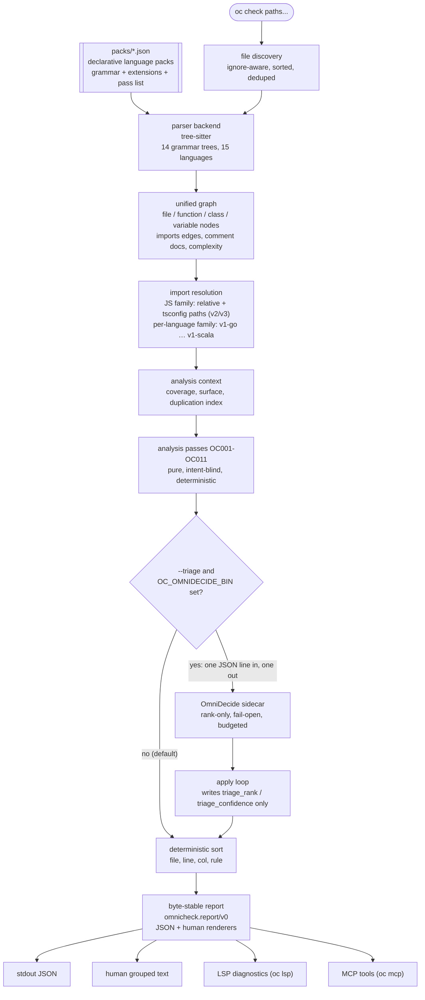

The sidecar box is the only non-deterministic-capable component in the diagram,
and the pipeline is built so that it *cannot matter*: with the box absent, the
report bytes are identical to the ranked run minus the two annotation fields.

---

## Module map

Dependency graph of the first-party modules (vendored tree-sitter runtime and
OmniDecide-C kernel shown as external boundaries):

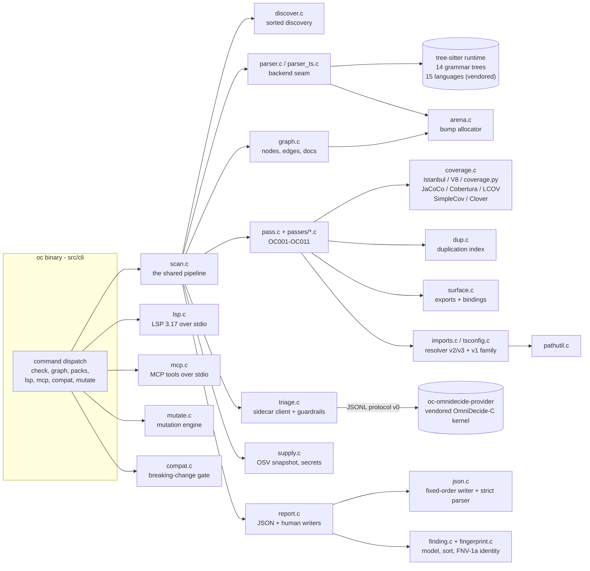

`scan.c` is the single seam under all surfaces — LSP and MCP sessions produce
findings byte-identical to a plain `oc check` for the same inputs.

---

## Static structure

The core domain objects and how they compose (public C11 API, `include/oc/`):

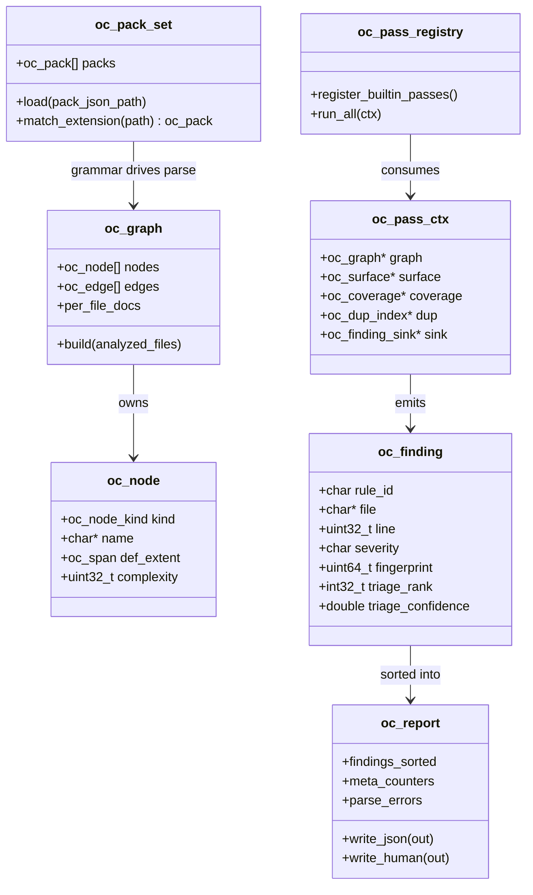

Notes on the model:

- Every function node carries **one** canonical span (the definition extent);
  OC001, OC004, OC007 and the coverage composition all read the same field.
- `fingerprint` is FNV-1a 64-bit over `rule_id, file, anchor[,
  normalized_snippet]` — line numbers are deliberately excluded so findings
  survive code motion.
- `triage_rank` / `triage_confidence` are the ONLY fields the sidecar can write;
  they default to "unranked" and every consumer sees the confidence value
  (confidence-exposed guardrail).

---

## The rule registry

Exactly as registered by `src/passes/*.c` (`scripts/audit_docs.py` derives this
table from the code and fails the M5 docs gate if it drifts):

| Rule | Name | Severity | Fires when |
| --- | --- | --- | --- |
| OC001 | long-function | warn | function definition spans more than `OC001.max_lines` (default 60) |
| OC002 | todo-comment | info | comment carries an open TODO / FIXME / HACK marker |
| OC003 | import-cycle | warn | strongly connected component of import edges spans > 1 file |
| OC004 | complex-function | warn | cyclomatic complexity above `OC004.max_complexity` (default 15); no-coverage CRAP proxy |
| OC005 | unused-export | warn | export never referenced by any analyzed import binding (ambiguous import forms fail open) |
| OC006 | unreferenced-module | info | analyzed file with no inbound import edges, claimed by no entry-point rule |
| OC007 | crap-hotspot | warn | CRAP(m) = comp² × (1 − cov/100) + comp above `OC007.max_crap` (default 30), coverage composed |
| OC008 | duplicate-code | warn | normalized block (`OC008.min_block`, default 10) duplicated verbatim in 2+ locations |
| OC009 | dep-vuln | error | pinned dependency matches the vendored OSV snapshot (unpinned: warn; ranges never guessed) |
| OC010 | licence | warn | manifest declares no licence |
| OC011 | secret-pattern | error | credential-shaped pattern in source (AWS AKIA, PEM, GitHub `ghp_`, Slack `xox`; generic secret-name: warn) |

Every rule is intent-blind and deterministic. Supply-chain rules (OC009–OC011)
run on manifests and raw sources through the same registry as the code rules —
there is no second judgment path.

---

## Language packs (register-not-train)

`packs/<id>/pack.json` declares schema version (`omnicheck.pack/v0`), id,
grammar, extensions, entry-point globs and the enabled pass list. Adding a
language = vendor its grammar at a dual-source-proven pin, add one descriptor
entry in `src/parser_ts.c`, write a `pack.json`. **No tool code changes;
passes are language-agnostic by construction** — which is why every pack below
ships the full OC001–OC011 set.

### The 15-language capability matrix

Identical facts to the rendered figure in [Screenshots](#screenshots);
authoritative contracts in `docs/LANGUAGES.md`.

| Language | Pack | Vendored grammar (pin) | Ext. scanner | Import resolver | Coverage adapter | Supply manifests | OSV | Entry claim |
| --- | --- | --- | --- | --- | --- | --- | --- | --- |
| JavaScript | `ts-js` | tree-sitter-javascript v0.25.0 | template chars | v2/v3 + tsconfig paths | Istanbul / V8 | package.json | npm | `main.js`, `**/index.js` globs |
| TypeScript | `typescript` | tree-sitter-typescript v0.23.2 (ts) | none | v2/v3 + tsconfig paths | Istanbul / V8 | package.json | npm | `**/index.ts` glob |
| TSX | `tsx` | tree-sitter-typescript v0.23.2 (tsx) | none | v2/v3 + tsconfig paths | Istanbul / V8 | package.json | npm | `**/index.tsx` glob |
| Python | `python` | tree-sitter-python v0.25.0 | indent / dedent | v3 package-root probing | coverage.py JSON | pyproject.toml · requirements.txt | PyPI | `main.py`, `**/__main__.py` globs |
| Go | `go` | tree-sitter-go v0.25.0 (grammars org) | none | v1-go dotted → whole package | go coverprofile text | go.mod | Go | `main.go` glob + `package main` fact |
| Java | `java` | tree-sitter-java v0.23.5 | none | v1-java class-file model | JaCoCo XML | pom.xml | Maven | `Main.java`, `**/Application.java` globs |
| C# | `csharp` | tree-sitter-c-sharp v0.24.0 | interpolated strings, optional `;` | v1-csharp namespace dirs | Coverlet Cobertura XML | .csproj · packages.lock.json | NuGet | `Program.cs` glob + static-Main fact |
| Rust | `rust` | tree-sitter-rust v0.24.0 | raw strings, hash lifetimes | v1-rust mod-tree + use-tree | LCOV | Cargo.toml · Cargo.lock | crates.io | `lib.rs`/`main.rs` + `fn main` fact |
| Ruby | `ruby` | tree-sitter-ruby v0.23.1 | heredocs, delimited literals | v1-ruby require_relative + load roots | SimpleCov JSON | Gemfile · Gemfile.lock | rubygems | `bin/*`, `exe/*` globs |
| PHP | `php` | tree-sitter-php v0.24.2 (mixed php+html) | template text, interpolation braces | v1-php PSR-4/PSR-0 + require guard | Clover XML | composer.json · composer.lock | packagist | `index.php`, `**/bin/*` globs |
| C | `c` | tree-sitter-c v0.23.4 | none | v1-c quoted includes | gcovr Cobertura XML | none (honest empty) | none | main-definition parse fact |
| C++ | `cpp` | tree-sitter-cpp v0.23.4 (C grammar inlined) | raw strings, angle brackets | v1-cpp (shares the v1-c channel) + .h routing | gcovr Cobertura XML | none (honest empty) | none | main-definition parse fact |
| Kotlin | `kotlin` | tree-sitter-kotlin 0.3.8 (fwcd) | auto semicolons, interpolation | v1-kotlin declared-fact | Cobertura XML | none (honest empty) | none | top-level main fact |
| Swift | `swift` | tree-sitter-swift 0.7.1-with-generated-files (alex-pinkus) | block comments, raw string parts | v1-swift declared-fact + Package.swift targets | Cobertura XML | none (honest empty) | none | Package.swift target facts |
| Scala | `scala` | tree-sitter-scala v0.23.4 | significant indentation | v1-scala declared-fact + selector expansion | JaCoCo / Cobertura XML (shared reader) | none (honest empty) | none | object-main + `@main` facts |

"None (honest empty)" means no canonical manifest reader was fabricated for
the language: the pack contributes zero manifest rows rather than guessed ones
(Kotlin/Swift/Scala wave-3 and the C/C++ supply tier in v1).

### Adoption waves

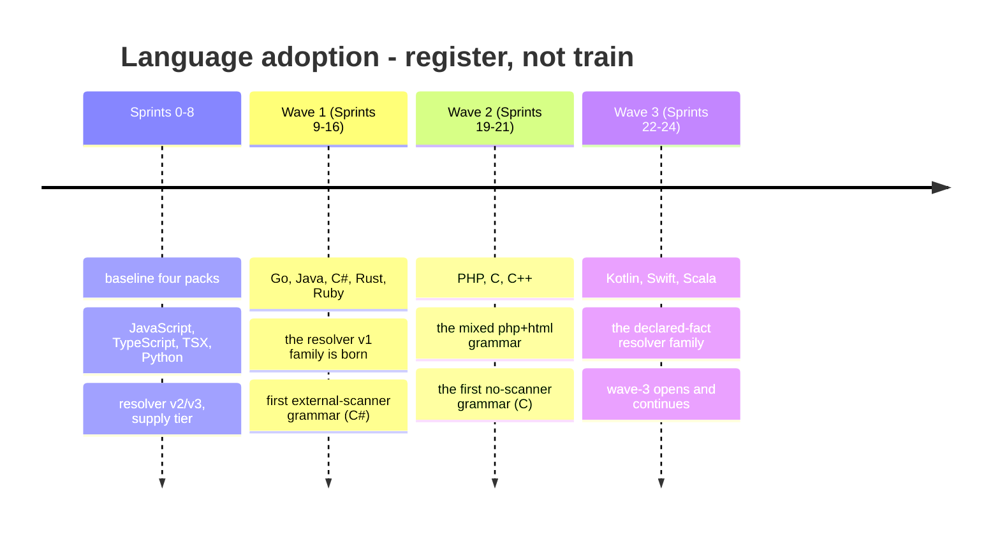

Full-scope pack order (each adoption = grammar pin + probe + pack + fixtures +
suite + gates, the fixed recipe): `java` → `csharp` → `rust` → `ruby` →
`php` → `c` → `cpp` → `kotlin` → `swift` → `scala`.

### Pack anatomy

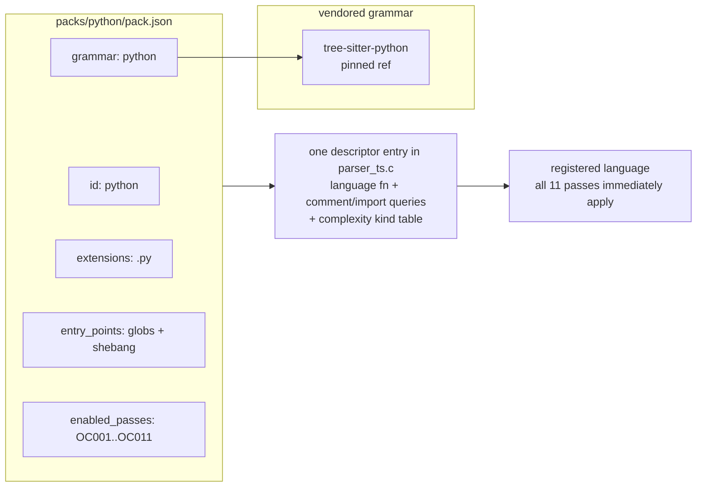

Import resolution is shared by all packs through one context
(`oc_resolve_ctx`), so import edges and surface usage marking can never
disagree. Unresolvable specifiers stay unresolved — never guessed — and
stdlib/site-packages names are out of scope by contract.

---

## The import-resolver family

Resolution is per-language by contract — each grammar's import shapes get an
explicit channel, and an edge always means "the target is part of this
analysis". Ambiguity fails open (NULL bind), externals stay unresolved.

| Resolver | Languages | Channel model | Fail-open behavior |
| --- | --- | --- | --- |
| v2/v3 + tsconfig | JavaScript, TypeScript, TSX | relative paths, tsconfig `paths`/`baseUrl` aliases, package-root probing (v3) | bare specifiers without an alias stay unresolved; stdlib out of scope |
| v1-go | Go | dotted imports resolve to whole-package edges; `package main` claiming | name-level usage not modeled — OC005 verdict set honestly empty for Go |
| v1-java | Java | single-type/static imports → the one class file they name; wildcard = package claim (fan-out) | nested classes and every external name (JDK, classpath, Maven) unresolved — no manifest is ever read |
| v1-csharp | C# | plain usings → namespace directory (dots-to-slashes); static usings → the type file; aliases probed in documented order | no MSBuild reading; unmatched usings stay unresolved |
| v1-rust | Rust | mod-tree (`mod name;` → module file by stem rule) + use-tree (crate/self/super anchors with item-reading pop ladder) | external crate heads stay unresolved — no Cargo read by the resolver |
| v1-ruby | Ruby | `require_relative` against the requiring file's directory; bare requires through the two documented load-root conventions | the Gemfile decoy discipline: gem names never resolve to files |
| v1-php | PHP | `use` declarations through the composer.json PSR-4/PSR-0 mapping of the analysis root (longest prefix); require/include with the exact-one-static-string guard | dynamic/variable requires stay unresolved |
| v1-c / v1-cpp | C, C++ | quoted includes against the including file's directory; the approved `.h` content-sniff + project-root routing treatment (header_routing report block) | system includes and macro paths stay unresolved/recorded |
| v1-kotlin / v1-scala | Kotlin, Scala | **declared-fact**: imports resolve against RECORDED package clauses + top-level declaration names of the analyzed set; wildcard fan-out; single requires the declared symbol; Scala adds the selector-expanding channel (`{A, B}` → one record per selector, both `_` and `*` normalize to `.*`) | the ambiguous member shape keeps a NULL bind; nothing guessed from directories or manifests |
| v1-swift | Swift | declared-fact module channel + Package.swift declared `(target, path)` hints as compilation TARGETS; `#if` directives flattened | files outside every declared target stay module-less — never import targets |

---

## OmniDecide triage sidecar

The OmniDecide-C kernel is vendored **unmodified** under
`third_party/omnidecide/` (Apache-2.0, pinned by zip sha256 + per-file
`VENDOR.sha256` manifest — see its `PROVENANCE.md`). The build compiles it as
the upstream CMake target `omnidecide` and links exactly two first-party
binaries against it:

- `oc-omnidecide-provider` — the protocol-v0 sidecar used by `oc --triage`;
- `oc-omnidecide-explain` — a post-hoc auditor (never a pipeline component),
  the only binary allowed to fail **closed** (exit 2 on contract violations).

### Protocol v0 (one JSON line in, one JSON line out)

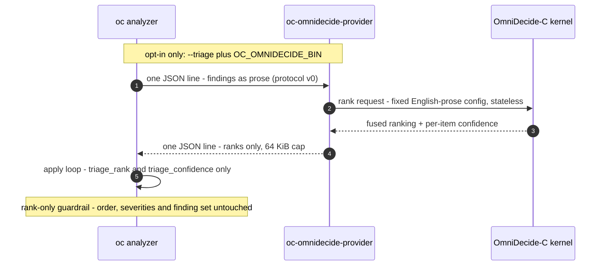

A real ranked run through this protocol is captured in the
[Screenshots](#screenshots) section.

### Failure modes (four, all fail-open)

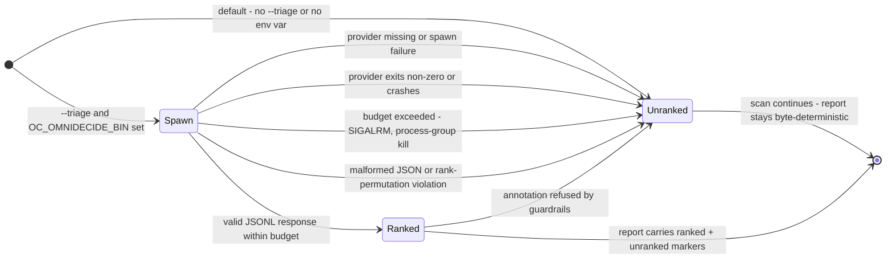

The provider never sees code, only findings prose (prose-class guardrail), and
runs against a fixed config — never the adaptive brain — so ranked reports are
byte-deterministic too. The strict time budget (one knob,
`OC_OMNIDECIDE_TIMEOUT_S`, 1..600 s) means a wedged adviser can freeze nothing.

### Budget profiles

Pick deliberately; the interactive default is a design decision, not a gap:

| Profile | Budget | Purpose | What the evidence says |
| --- | --- | --- | --- |
| interactive (default) | 3 s | developer-facing scans | fail-open at pathological scale is the honest result: 30,200 findings need ~34 s of kernel time regardless of text caps (measured) |
| CI depth | 60 s | scheduled full-repo runs | ranks ~928 of 2,380 findings on the pinned eslint corpus inside the budget |

### Audit trail and replay (default OFF)

- **Run-artifacts channel** — `OC_OMNIDECIDE_ARTIFACTS_DIR` makes the provider
  write `request-<pid>.json` (the byte-exact request — the replay pin) and
  `triage-<pid>.json` (the FULL uncapped ranked list with per-item explain
  components). Best-effort by contract: stdout is emitted first and is the only
  pipeline input; artifacts are documentation, never an input
  (`tests/test_triage_audit` proves report bytes are identical with the
  channel on or off).
- **Replay ritual** — the kernel is deterministic and the pin carries the
  request byte-for-byte, so re-deriving a past ranking is an exact byte replay:

  ```sh
  build/default/oc-omnidecide-provider < artifacts/request-<pid>.json > replayed.json
  diff replayed.json captured_response.json   # byte-identical = exact replay
  ```

- **Explain auditor** — `oc-omnidecide-explain` dumps per-item fused components
  ("why is this finding ranked here?") and audits a captured response against
  its request, exiting 2 on model mismatch, ambiguous ids, confidence mismatch
  (4 decimals), broken rank monotonicity or rank-sequence violations.

**Sibling-identity contract:** fingerprints deliberately exclude line numbers,
so byte-identical siblings (the same statement twice in one file) share one
identity and are annotated together; one id behind two different texts is the
defect class the auditor refuses (both directions test-locked in
`tests/test_triage_audit`).

---

## Determinism contract

1. Discovery sorts and dedupes; findings sort by `(file, line, col, rule)`.
2. Reports contain no wall-clock timestamps or durations; the JSON writer emits
   a fixed field order (`omnicheck.report/v0`).
3. Fingerprints are FNV-1a 64-bit over length-prefixed
   `rule_id, file, anchor[, normalized_snippet]` — line/column excluded so
   findings survive code motion; comment findings fold in normalized marker
   text to stay distinct.
4. `tests/test_cli` asserts byte-identical reports across runs; the M5
   determinism audit asserts ONE digest across all four build cells on a
   10,000-file corpus (digest committed in the evidence bundle).

Memory strategy: analysis structures are arena-allocated and freed in one shot;
growables have explicit destroy functions; the sanitize preset runs the whole
suite under ASan+UBSan with leak detection.

---

## Verification and evidence

### The build matrix

| Cell | Compiler | Configuration | Result at the SPRINT-24 tree (2026-11-23) |
| --- | --- | --- | --- |
| default | gcc 14.2 | Release, `-Werror` | 38/38 ctest entries |
| sanitize | gcc 14.2 | ASan+UBSan+LSan | 37/38 — `test_fuzz` SIGKILLed by this host's documented 4 GiB cgroup; green in Release and on unrestricted hosts |
| clang-release | clang 19.1.7 | Release, `-Werror` | full suite green (last full four-cell proof: M5 audit) |
| clang-sanitize | clang 19.1.7 | ASan+UBSan+LSan | full suite green (last full four-cell proof: M5 audit) |

Cross-compiler report bytes: identical (M1 carried item, closed with
committed evidence). The M5 determinism audit re-proven at the SPRINT-24 tree:
ONE report digest across all cells, worst Release wall **14.6 s** vs the 90 s
budget (`docs/evidence/m5_gate_verdict.json`).

### Gate-day dogfood chain

Each milestone gate's OWN pre-condition chain was executed through the
mechanized runner (`scripts/acceptance/gate_day_runner.py`), one evidence
bundle per gate under `docs/evidence/gate_day/`:

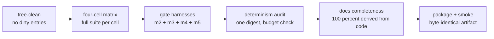

M1 (2026-11-18), M2–M4 (2026-11-19) and M5 (re-audited 2026-11-19 → 2026-11-23
at each adoption) are all green — 6/6 steps per bundle. The ritual caught
**four real defects in its own machinery** on its first runs (an LSan-reachable
arena leak, a runner bug on the first harness-bearing gate, a "2 distinct
digests" audit artifact, and a mutation-JSON control-character escape); each
was fixed and committed BEFORE the affected gate was re-proven green.

### Milestone acceptance harnesses

| Harness | Gate | Reference (pinned) | Result |
| --- | --- | --- | --- |
| `m2_gate.py` | M2 Alpha | eslint `21026992e3520869b31ca4500905665942bb2cf0`, `lib/` = 394 files / 107,039 LOC TS/JS | 5 rules firing, 10 runs byte-identical, 0.60 s wall (budget 60 s) |
| `m3_gate.py` | M3 Beta | psf/black `c0e143e75443afd3be50c3b63ed2ee2fd108f509`, `src/black` = 25 files / 16,731 LOC Python | 25/25 analyzed, 0 parse errors, 257 findings across 7 rules, 70 import edges resolved |
| `m4_gate.py` | M4 RC | committed demo fixtures | CRAP leaderboard live on both packs; mutation 10 mutants → 9 killed, exactly 1 survivor (the unchecked arg-swap); compat gate BREAKING/SAFE verdicts; supply-chain findings on seeded fixture |
| `m5_gate.py` | M5 GA | 10k generated corpus | one digest across cells; worst Release wall 14.6 s vs 90 s budget; docs 100%; packaged binary smoke byte-identical |

### Fuzz suite (in every cell)

`tests/test_fuzz.c` layers three deterministic targets: seeded byte-mutations
of the example corpus scanned twice in-process (byte-identical reports
required), a committed adversarial corpus through the real binary, and
malformed-JSON attacks on the strict parser and the coverage/OSV loaders.
Exit codes stay in {0, 1, 2}; every exit 2 names its parse errors.

### Vendored kernel self-checks

The kernel's own suites run unmodified from the vendored root:
`odk_smoke_test` (373 checks) + `odk_spine_test` (210 checks) = **583 checks
green in-repo**, clean under ASan+UBSan+LSan; `test_triage_real` drives the
real provider end-to-end in every build cell.

---

## Milestones

Formal gate dates come from the project plan (Table 9) and are unchanged; all
chains were rehearsed early per the rehearse-early convention.

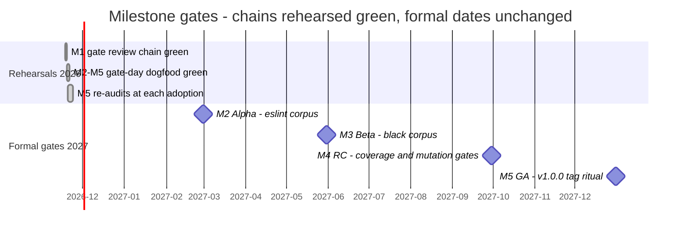

The v1.0.0 tag is NOT cut early: the mechanical ritual is
`docs/V1_TAG_RITUAL.md` and executes on the formal gate date (steps 7–9 are
human-owned by design).

---

## Repository layout

| Path | Purpose |
| --- | --- |
| `include/oc/` | public C11 API (arena, json, graph, pack, parser, pass, triage, …) |
| `src/` | implementation; `src/passes/` built-in rules; `src/cli/` the `oc` binary |
| `packs/` | declarative language packs (`pack.json` per language) |
| `third_party/` | vendored tree-sitter runtime + grammars (re-provisioned by `scripts/vendor.sh`); the OmniDecide-C kernel (`omnidecide/`, committed and integrity-pinned) |
| `tests/` | unit + integration suites (36 suites + 2 vendored kernel suites = 38 ctest entries), fuzz corpus, fixtures |
| `scripts/` | vendoring, packaging, snapshots, acceptance gates, determinism audit, docs audit, screenshot pipeline |
| `templates/` | CI gate templates (composite GitHub Action + workflow) |
| `examples/` | intentionally smelly demo code for the demo report |
| `tools/` | provider + explain auditor sources, protocol mock |
| `npm/` | the npm shim (execs the native binary, nothing reimplemented in JS) |
| `docs/` | architecture contract, language contracts, sprint records, evidence bundles, screenshots |
| `dist/` | release artifacts (regenerate with `scripts/package.sh`) |

---

## Documentation map

| Document | Content |
| --- | --- |
| `docs/ARCHITECTURE.md` | the full engineering contract: pipeline, module responsibilities, resolution/duplication/coverage contracts, triage guardrails |
| `docs/LANGUAGES.md` | the per-language adoption contracts (all 15 languages): grammar pins, symbol kinds, decision tables, resolver semantics, honesty invariants |
| `docs/SPRINT-0..24.md` | per-sprint records with observed-defect logs (the SPRINT-24 record covers the Scala adoption) |
| `docs/M1_GATE_REVIEW.md` / `M1_KILL_SWITCH.md` | gate review and the kill-switch criterion |
| `docs/GATE_DAY_DOGFOOD.md` | the gate-by-gate rehearsal record (four real catches) |
| `docs/OMNIDECIDE_LEVERAGE.md` | the eight-option leverage memo (L-track adoption record) |
| `docs/TRIAGE_CALIBRATION_WORKFLOW.md` | how budgets are calibrated as outcome data arrives (design) |
| `docs/TRACK_B_OWNERSHIP.md` / `docs/B3_COMPAT_SIGNATURE_DIFFS.md` / `docs/RITUAL_DRESS_REHEARSAL.md` | ownership split, the compat signature-diff contract, the ritual rehearsal record |
| `docs/SCREENSHOTS.md` | how the README captures are produced (the byte-exact claim and the regeneration command) |
| `docs/V1_TAG_RITUAL.md` | the mechanical v1.0.0 tag ritual for the formal gate date |
| `docs/evidence/` | committed verdict JSONs, bundles, digests |
| `scripts/snapshot.sh` | git-archive-semantics snapshot cutter: tracked HEAD only, dirty-tree refusal, leak self-check, sha256 sidecar |

---

## License

Apache-2.0 for the first-party code; see `LICENSE` (canonical text) and
`NOTICE` (copyright and attribution). Vendored third-party components keep
their own licenses: MIT (tree-sitter runtime and grammars) and Apache-2.0
(OmniDecide-C kernel); see `THIRD_PARTY_NOTICES.md` for pinned versions and
`third_party/omnidecide/PROVENANCE.md` for the kernel's integrity manifest.

## Author

[**Tamer Osman**](https://github.com/tamer4osman) — Project creator and maintainer.
